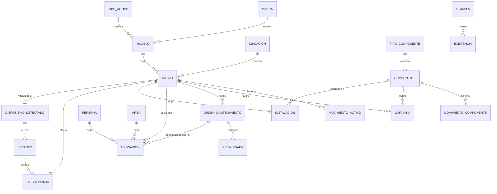

# ScanGP → Plataforma de gestión de activos tecnológicos (ITAM)

Estado: **implementado (fases 0 a 6)** el 27 nov 2026 sobre SQL Server. Pendiente: diseño definitivo de las pantallas nuevas, actas en PDF y etiquetas QR.
Fecha: 27 nov 2026. Reglas visuales en [`web-react/DESIGN.md`](../web-react/DESIGN.md).

---

## 1. Auditoría del proyecto actual

### Inventario del código (≈ 6.500 líneas)
| Pieza | Tecnología | Tamaño | Qué hace hoy |
|---|---|---|---|
| `agente-windows/` | C# · .NET Framework 4.8 · WMI · compilado con `csc` | ~1.650 líneas | ScanGP.exe: recolecta hardware/SO/software, lo envía a `POST /api/inventario` con `X-Api-Key`. Modo ventana, silencioso y solo-local. Configuración embebida al final del `.exe` |
| `api-nest/` | NestJS 11 · un solo módulo `inventario` | ~470 líneas | Recibe el inventario, identifica el equipo (UUID → serie → MAC → nombre), guarda **el último inventario** + lista de cambios en `data/equipos.json`, entrega ScanGP.exe preconfigurado |
| `web-react/` | React 18 · TS · Vite · PrimeReact 10 · React Router 6 · Lucide | ~4.400 líneas | Lista de equipos detectados, ficha técnica por componente, compatibilidad, recomendaciones, diagnóstico, historial, asistente de detección |

### Base de datos
No hay base de datos. `EquiposRepository` mantiene un `Map` en memoria y lo vuelca completo a un archivo JSON en cada escritura (con escritura atómica vía `.tmp` + `rename`). Una entidad: `EquipoRegistrado { id, resumen, historial[], inventario }`.

### Qué se reutiliza
| Elemento | Por qué sirve | Destino |
|---|---|---|
| **ScanGP.exe completo** | Detección madura: chasis, RAM (incl. soldada), discos NVMe/SSD/HDD, monitores EDID, batería, software. Configuración embebida sin instalación. Modos para GPO/Intune | Se conserva tal cual. Solo se le **agregan** campos opcionales |
| Contrato `POST /api/inventario` + `ApiKeyGuard` | Lo usan los ScanGP ya repartidos | Se mantiene idéntico (módulo *Descubrimiento*) |
| Algoritmo de identificación del equipo | Base correcta (UUID → serie → MAC) | Se conserva y se endurece (ver riesgo R4) |
| `detectarCambios` | Idea correcta | Se reemplaza por reconciliación a nivel de componente |
| Endpoint de descarga de ScanGP | Funciona y es cómodo | Se mantiene, protegido con login |
| Sistema de diseño (`tokens.css`, `components/ui/*`) | Ya cumple: fondo blanco, un acento, Lucide, sin sombras ni tarjetas | Se amplía con tabla administrativa, pestañas, formularios, diálogos |
| Páginas técnicas (Procesador, Memoria, Discos…) y reglas de Compatibilidad/Diagnóstico/Recomendaciones | Reglas puras y probables, sin datos ficticios | Pasan a la pestaña **Detección** de la ficha del activo |
| `services/http.ts`, `usePolling`, estado de conexión | Capa de datos limpia | Se amplía con `postJson`/`patchJson` y token de sesión |

### Limitaciones que impiden el alcance ITAM
1. **Sin base de datos relacional ni transacciones**: imposible garantizar trazabilidad (asignar + mover + auditar debe ser atómico).
2. **Un "equipo" es un escaneo**: no existe el concepto de activo administrativo, código patrimonial, responsable, ubicación ni estado. Lo que no ejecuta ScanGP (impresoras, celulares, equipos de red, monitores sueltos) no puede registrarse.
3. **Componentes sin identidad**: son filas dentro del JSON del último escaneo; no pueden moverse a otro equipo ni a almacén.
4. **Historial recortado y borrable**: `historial.slice(0, 200)` descarta cambios antiguos y `DELETE /api/equipos/:id` borra el equipo **con todo su historial**. Contradice la regla "no eliminar relaciones históricas".
5. **Solo se guarda el último inventario**: no hay instantáneas por escaneo (ya anotado en DESIGN.md v1 §11).
6. **Sin usuarios ni login**: los endpoints de lectura, el borrado y la descarga del `.exe` (que contiene la API key) están abiertos a la red. No se puede auditar "quién hizo qué".
7. **Sin validación de entrada** (no hay DTOs con `class-validator`) y **sin pruebas automatizadas**.
8. **Marca fija**: el icono de ScanGP es el logo de una empresa concreta; el nombre y el logo no son configurables.

---

## 2. Riesgos

| # | Riesgo | Impacto | Mitigación |
|---|---|---|---|
| R1 | Migrar de JSON a base de datos pierde o duplica equipos | Alto | Importador idempotente, de solo lectura sobre el JSON (que se conserva como respaldo). Se ejecuta en seco primero y muestra un informe |
| R2 | Cambiar el contrato rompe los ScanGP ya repartidos | Alto | `POST /api/inventario` no cambia. Campos nuevos siempre opcionales. Prueba de contrato con un JSON real |
| R3 | Una sola API key compartida: quien tenga el `.exe` puede enviar inventarios falsos y no se puede revocar a uno | Medio | Fase 0: proteger descarga con login. Más adelante: token de inscripción por instalación, revocable |
| R4 | **Equipos distintos fusionados en uno**: placas genéricas reportan UUID/serie de relleno (`03000200-0400-0500-0006-000700080009`, `FFFFFFFF-…`, `To be filled by O.E.M.`, `Default string`, `0`) | Alto | Lista de valores inválidos; se salta al siguiente identificador. Si hay duda, se crea discrepancia "posible duplicado" en vez de fusionar |
| R5 | Componentes sin número de serie (RAM soldada, CPU, GPU integrada) no se pueden rastrear de forma fiable | Medio | Se clasifican como **integrados** (forman parte del activo) y no como **rastreables**. Solo los rastreables tienen identidad y movimientos propios |
| R6 | La reconciliación automática genera ruido (muchas discrepancias falsas) | Medio | Solo se comparan componentes rastreables y atributos clave. Cambios de usuario de Windows, IP, SO o software actualizan el dato detectado, **no** generan discrepancia |
| R7 | Alcance muy grande (11 módulos) | Alto | Entrega incremental por fases; cada fase funciona sola y no rompe lo anterior (§6) |
| R8 | Escrituras concurrentes sobre el mismo activo (dos técnicos asignan a la vez) | Medio | Transacciones + columna `version` (bloqueo optimista) en entidades con estado |
| R9 | Datos personales (responsables, usuarios de Windows) | Medio | Login obligatorio, roles, auditoría de lectura de datos sensibles opcional |
| R10 | **SQL Server Express limita cada base a 10 GB.** Un escaneo real pesa ≈ 11 KB (medido: LAP-SISTEMAS, 6 KB de ellos son software). Guardando todos, 500 equipos escaneados a diario suman ≈ 2 GB al año más índices y auditoría: el límite se alcanzaría en pocos años | Medio | Guardar el escaneo completo **solo si cambió** (`datos_hash` SHA-256 del contenido sin campos volátiles como fecha, IP o tiempo encendido); si no cambió, solo se actualiza `ultimo_reporte`. Software en tabla aparte, deduplicado. Compresión de página o `COMPRESS()` sobre `datos`. Política de retención configurable para escaneos sin cambios. Medir el tamaño real en la Fase 1 y decidir si producción necesita edición Standard |

---

## 3. Arquitectura funcional

### Principio rector
Dos mundos separados que solo se tocan mediante **vinculación** y **discrepancias**:

```
  MUNDO DETECTADO (lo que dice la máquina)          MUNDO ADMINISTRATIVO (lo que valida TI)
  ─────────────────────────────────────────         ─────────────────────────────────────────
  ScanGP.exe ──► Escaneo (instantánea inmutable)     Activo (código patrimonial, responsable,
                  │                                   ubicación, estados)
                  ▼                                     │
           Dispositivo detectado ◄──── vínculo 1:1 ────┤
                  │                                     ▼
                  ▼                                   Componente rastreable ── Instalación (desde/hasta)
           Reconciliación ──► Discrepancia ──► (técnico acepta) ──► operación de dominio + auditoría
                                              └► (técnico rechaza) ──► queda registrada, nada cambia
```

Un escaneo **nunca** modifica el inventario validado. Solo un usuario, aceptando una discrepancia u operando a mano, cambia el mundo administrativo.

### Módulos (contextos delimitados) en `api-nest/src/`
| Módulo Nest | Responsabilidad | Depende de |
|---|---|---|
| `identidad` | Usuarios del sistema, roles, sesión (JWT) | — |
| `auditoria` | Registro inmutable de toda operación (actor, acción, entidad, antes/después) | identidad |
| `organizacion` | Personas (custodios), áreas, sedes, ubicaciones, configuración de la organización (nombre, logo, formato de código patrimonial) | — |
| `catalogo` | Tipos de activo, tipos de componente, marcas, modelos, plantillas de especificación | — |
| `descubrimiento` | `POST /api/inventario`, escaneos, dispositivos detectados, reconciliación, discrepancias, descarga de ScanGP | catalogo (solo lectura) |
| `activos` | Alta, edición, estados, ciclo de vida, vinculación con dispositivo detectado | catalogo, organizacion |
| `componentes` | Componentes rastreables, instalación/retiro/reemplazo | activos, almacen |
| `asignaciones` | Asignación permanente, préstamo, reemplazo temporal, devolución, transferencias | activos, organizacion |
| `almacen` | Almacenes, existencias de repuestos, movimientos de entrada/salida | catalogo, organizacion |
| `mantenimiento` | Órdenes preventivas/correctivas, planes preventivos, tareas, piezas usadas | activos, componentes, asignaciones |
| `garantias` | Garantías y contratos de soporte por activo o componente; alertas de vencimiento | activos, componentes |
| `documentos` | Adjuntos (factura, acta de entrega, informe técnico) vinculados a cualquier entidad | — |

Reglas de diseño:
- Cada módulo expone **servicios de aplicación** (casos de uso: `asignarActivo`, `instalarComponente`…). Los controladores no contienen lógica.
- Las reglas de negocio viven en funciones/clases de dominio puras, testeables sin base de datos.
- Un caso de uso = una transacción que: valida → cambia el estado actual → escribe el movimiento histórico → escribe la auditoría. Si algo falla, nada se guarda.
- Los módulos se comunican por servicios públicos, nunca leyendo tablas de otro módulo.
- La auditoría se escribe con un interceptor común + llamada explícita en cada caso de uso (con antes/después).

### Ejes de estado separados (activo)
| Eje | Valores | Quién lo cambia | Cómo se guarda |
|---|---|---|---|
| **Ciclo de vida** | `ALTA_PENDIENTE` · `EN_SERVICIO` · `FUERA_DE_SERVICIO` · `DADO_DE_BAJA` | Alta, baja, reactivación | columna + `movimiento_activo` |
| **Estado técnico** | `SIN_EVALUAR` · `OPERATIVO` · `CON_FALLAS` · `AVERIADO` · `IRREPARABLE` | Técnico, cierre de mantenimiento | columna + movimiento |
| **Asignación** | `DISPONIBLE` · `ASIGNADO` · `PRESTADO` · `RESERVADO` | Módulo asignaciones | **derivado** de la asignación vigente (no se guarda dos veces) |
| **Ubicación** | referencia a `ubicacion` (sede › área › lugar, almacén, taller, proveedor) | Transferencias, almacén, mantenimiento | `ubicacion_id` + movimiento |
| **Sincronización** | `NO_APLICA` · `SIN_VINCULAR` · `SINCRONIZADO` · `CON_DISCREPANCIAS` · `SIN_REPORTE` | Descubrimiento | **derivado** (vínculo, discrepancias abiertas, fecha del último escaneo) |
| *En mantenimiento* | sí/no | — | **derivado** de una orden de mantenimiento abierta |

Derivar en vez de duplicar evita estados contradictorios (por ejemplo, "Disponible" con una asignación vigente).

Los componentes rastreables tienen los mismos ejes salvo sincronización, y su "ubicación" puede ser *instalado en activo X* o *almacén Y*.

### Ciclo de vida de un componente rastreable
```
            ┌────────── retirar ──────────┐
            ▼                             │
  [Almacén] ─── instalar ───► [Instalado en activo A] ── reemplazar ──► (otro componente entra, este pasa a Almacén o Mantenimiento)
     │  ▲                                  │
     │  └──── devolver ── [Mantenimiento] ◄┘ enviar a mantenimiento
     │
     └──── dar de baja ───► [Dado de baja]   (terminal; el registro y su historia se conservan)
```
Cada flecha crea una fila en `movimiento_componente`. La instalación es una fila en `instalacion` con `desde`/`hasta`; retirar **cierra** la fila (rellena `hasta`), nunca la borra. "¿Qué tenía el equipo A el 3 de marzo?" se responde con una consulta.

### Reemplazo temporal durante mantenimiento
1. Se abre una orden de mantenimiento para el activo principal del trabajador.
2. El sistema sugiere crear una asignación `TEMPORAL_REEMPLAZO` de un activo disponible, ligada a la orden (`asignacion.orden_mantenimiento_id`).
3. Al cerrar la orden, el sistema pide confirmar la devolución del temporal; la asignación principal nunca se cerró, solo quedó "en mantenimiento".

### Reconciliación (detección → discrepancias)
Cada escaneo de un dispositivo **vinculado** a un activo:
1. Se guarda el escaneo íntegro (inmutable).
2. Se extraen las *huellas* de componentes detectados: `(tipo, número de serie)`; si no hay serie, `(tipo, modelo, capacidad, ranura)` con confianza baja.
3. Se comparan con los componentes rastreables **instalados** en el activo.

| Caso | Discrepancia generada | Acción al aceptar |
|---|---|---|
| Huella detectada que no está instalada y existe en el sistema (en almacén u otro activo) | `COMPONENTE_MOVIDO` | Retirar del origen + instalar aquí |
| Huella detectada desconocida | `COMPONENTE_NUEVO` | Crear componente + instalar |
| Componente instalado que ya no aparece | `COMPONENTE_AUSENTE` | Retirar (destino a elegir: almacén, mantenimiento, baja/extraviado) |
| Atributo clave distinto (serie de placa, modelo del equipo) | `ATRIBUTO_DIFERENTE` | Actualizar el dato validado |
| UUID/serie de otro activo, o identificador sospechoso | `POSIBLE_DUPLICADO` | Vincular al activo correcto o separar |

Rechazar una discrepancia la deja registrada con motivo; si la siguiente detección repite exactamente lo mismo, no se vuelve a abrir.

Un dispositivo detectado **sin vincular** no genera discrepancias: aparece en la bandeja "Detectados sin registrar", desde donde se crea un activo nuevo prellenado o se vincula a uno existente (por ejemplo, un activo registrado a mano por su serie).

---

## 4. Modelo de datos

Motor: **SQL Server** (decidido). Desarrollo sobre SQL Server 2019 Express (`.\SQLEXPRESS`); producción en la edición que tenga la organización (2019 o posterior).
ORM: **TypeORM 0.3** con `@nestjs/typeorm` 11 y el driver `mssql`. Migraciones generadas, versionadas en el repo y revisadas a mano antes de aplicarse; `synchronize` siempre desactivado.

Por qué TypeORM y no Prisma con SQL Server:
| Necesidad | Prisma + SQL Server | TypeORM + SQL Server |
|---|---|---|
| Columnas JSON (escaneos, especificaciones, auditoría) | tipo `Json` **no soportado**: texto sin tipado | `simple-json` sobre `NVARCHAR(MAX)` + `CHECK (ISJSON(col) = 1)` |
| Índice único filtrado ("una instalación vigente por componente") | no declarable; SQL manual en cada migración | `@Index({ unique: true, where: '[hasta] IS NULL' })` |
| Transacciones en casos de uso | sí | sí (`DataSource.transaction`) |
| Integración con Nest | paquete de terceros | módulo oficial |

Tipos y convenciones en SQL Server:
- Claves `UNIQUEIDENTIFIER` generadas en la aplicación como **UUID v7** (ordenadas por tiempo: evitan la fragmentación del índice agrupado que causan los UUID aleatorios).
- Fechas `DATETIME2(3)` en UTC. Texto `NVARCHAR` (tildes y ñ). Importes `DECIMAL(12,2)`.
- Intercalación por defecto insensible a mayúsculas y acentos (`Modern_Spanish_CI_AI`) para búsquedas; códigos y series se normalizan a mayúsculas al guardar.
- Columnas JSON: `NVARCHAR(MAX)` con `CHECK (ISJSON(...) = 1)`; los campos que se filtran (p. ej. `ramGB` del resumen) se exponen como **columnas calculadas persistidas** con `JSON_VALUE` e índice.
- Bloqueo optimista con columna `version` (entero que TypeORM incrementa en cada actualización) en las tablas de estado.
- Búsqueda de la tabla principal: índices sobre código, nombre, serie; texto completo (Full-Text Search) solo si hace falta más adelante (Express lo incluye con *Advanced Services*).

Convenciones:
- Todas las tablas tienen `id`, `creado_en`, `creado_por`; las de estado, `actualizado_en` y `version`.
- Tablas de **estado actual** (se actualizan): `activo`, `componente`, `existencia`.
- Tablas de **historia** (solo `INSERT`): `escaneo`, `movimiento_*`, `instalacion` (solo se rellena `hasta` una vez), `auditoria`. El usuario de SQL de la aplicación tiene `DENY UPDATE, DELETE` sobre ellas (y `DENY DELETE` sobre `instalacion`, cuyo cierre se hace con un procedimiento que solo rellena `hasta` si es `NULL`).
- Dos usuarios de SQL: `scangp_migraciones` (dueño del esquema, solo para migrar) y `scangp_app` (lectura/escritura limitada). Esquema propio `itam`.
- Nada se borra físicamente: las bajas son estados; los catálogos usan `activo BIT`.



### Tablas principales
| Tabla | Campos clave |
|---|---|
| `organizacion_config` | nombre, logo, prefijo y formato del código patrimonial, días para "sin reporte" |
| `sede` · `area` · `ubicacion` | jerarquía; `ubicacion.tipo`: `PUESTO` · `ALMACEN` · `TALLER` · `PROVEEDOR` · `OTRO` |
| `persona` | nombre, documento, correo, área, cargo, `activo` (custodios; **no** son usuarios del sistema) |
| `usuario` · `rol` | login de la plataforma; roles `ADMIN` · `TECNICO` · `CONSULTA` |
| `marca` · `tipo_activo` · `modelo` | `modelo.especificaciones` (JSON) validadas por `tipo_activo.plantilla_especificaciones` |
| `tipo_componente` | RAM, disco, batería, monitor, cargador, GPU dedicada…; `rastreable_por_defecto` |
| `activo` | `codigo_patrimonial` (único), `nombre` (hostname), `tipo_activo_id`, `modelo_id`, `numero_serie`, `ubicacion_id`, `ciclo_vida`, `estado_tecnico`, `fecha_adquisicion`, `costo`, `proveedor`, `especificaciones` (JSON) (validadas), `observaciones` |
| `componente` | `codigo` (único, interno), `tipo_componente_id`, `modelo`, `numero_serie`, `capacidad`, `atributos` (JSON), `estado_tecnico`, `ciclo_vida`, `almacen_id` (si está en almacén) |
| `instalacion` | `componente_id`, `activo_id`, `desde`, `hasta` (null = vigente), `motivo`, `orden_mantenimiento_id?` · índice único parcial: un componente solo puede tener una instalación vigente |
| `asignacion` | `activo_id`, `tipo` (`PERMANENTE` · `PRESTAMO` · `TEMPORAL_REEMPLAZO`), `persona_id?`/`area_id?`, `desde`, `hasta_previsto`, `hasta`, `orden_mantenimiento_id?`, `acta_documento_id?` · único parcial: una asignación vigente por activo |
| `movimiento_activo` / `movimiento_componente` | `tipo` (alta, transferencia, cambio de estado, baja…), `desde_*`, `hacia_*`, `fecha`, `usuario_id`, `motivo`, `referencia` (orden, asignación, discrepancia) |
| `almacen` · `existencia` · `movimiento_almacen` | repuestos **sin serie** por cantidad (tóner, cables, pasta térmica); los repuestos **con serie** son `componente` con `almacen_id` |
| `orden_mantenimiento` | `activo_id`, `tipo` (`PREVENTIVO` · `CORRECTIVO`), `estado` (`ABIERTA` · `EN_CURSO` · `EN_ESPERA` · `CERRADA` · `CANCELADA`), `falla_reportada`, `diagnostico`, `solucion`, `tecnico_id`, `proveedor_externo?`, fechas, `costo` |
| `plan_preventivo` | `tipo_activo_id` o `activo_id`, frecuencia, lista de tareas; genera órdenes |
| `pieza_usada` | `orden_id`, `componente_id?` o `existencia_id` + cantidad |
| `garantia` | `activo_id?` / `componente_id?`, proveedor, tipo, `inicio`, `fin`, número de contrato |
| `documento` | archivo (en disco o S3), tipo, `entidad`, `entidad_id`, hash |
| `dispositivo_detectado` | `huella` (clave de identificación actual), `activo_id?` (vínculo), `ultimo_escaneo_id`, `primer_escaneo`, `ultimo_reporte` |
| `escaneo` | `dispositivo_id`, `recibido_en`, `ip_origen`, `agente_version`, `datos` (JSON, inventario íntegro), `datos_hash`, `resumen` (JSON) |
| `discrepancia` | `escaneo_id`, `activo_id`, `tipo`, `detalle` (JSON), `estado` (`PENDIENTE` · `ACEPTADA` · `RECHAZADA`), `resuelta_por`, `resuelta_en`, `motivo` |
| `auditoria` | `fecha`, `usuario_id`, `ip`, `accion`, `entidad`, `entidad_id`, `antes` (JSON), `despues` (JSON) |

### Identificadores
- `id` (UUID v7, `UNIQUEIDENTIFIER`): técnico, inmutable, nunca se muestra como dato de negocio.
- `codigo_patrimonial` (activo) y `codigo` (componente): visibles, únicos, formato configurable (p. ej. `TI-000123`). Se pueden imprimir como etiqueta/QR.
- `huella` (dispositivo detectado): calculada por el algoritmo actual (UUID → serie → MAC), con lista de valores inválidos.

---

## 5. Navegación y pantallas

Detalle visual en `web-react/DESIGN.md` §5–§7.

```
Inicio                         Panel: pendientes (discrepancias, préstamos vencidos, garantías por vencer, sin reporte)
Inventario
  Activos                      Tabla principal
  Componentes                  Tabla de componentes rastreables
Operaciones
  Asignaciones                 Vigentes · Préstamos · Temporales · Historial
  Mantenimiento                Órdenes · Planes preventivos
  Garantías                    Vigentes · Por vencer · Vencidas
Almacén
  Existencias                  Repuestos por almacén
  Movimientos
Descubrimiento
  Discrepancias      (n)       Bandeja de validación
  Detectados                   Dispositivos detectados (vinculados y sin registrar)
  Desplegar ScanGP             Asistente actual de detección
Catálogo
  Tipos · Marcas · Modelos · Tipos de componente
Organización
  Personas · Áreas · Ubicaciones
Administración
  Usuarios y roles · Auditoría · Configuración
```

**Tabla principal de activos**: Código patrimonial · Equipo · Tipo · Marca · Modelo · Responsable · Ubicación · Estado. Búsqueda global, filtros por columna, selector de columnas (añade Serie, Área, Estado técnico, Sincronización, Último reporte, Garantía hasta), selección múltiple con acciones en lote, menú contextual por fila.

**Ficha del activo** (`/activos/:id`): cabecera compacta con código, nombre, tipo, modelo, los ejes de estado y acciones (Asignar, Transferir, Mantenimiento, Más ▾). Pestañas:
`General` · `Componentes` · `Asignaciones` · `Mantenimientos` · `Garantías` · `Documentos` · `Historial` · `Detección`.
La pestaña **Detección** contiene las páginas técnicas actuales (Procesador, Memoria, Discos, Compatibilidad, Diagnóstico…) leídas del último escaneo, con el aviso "Datos detectados por ScanGP el …; pueden diferir del inventario validado".

Rutas actuales (`/equipos`, `/equipos/:id/*`) se mantienen mientras dure la transición y luego redirigen a `/detectados/:id`.

---

## 6. Plan de implementación incremental

Cada fase termina con: migraciones revisadas, pruebas de los casos de uso, la funcionalidad anterior funcionando y ScanGP.exe sin cambios obligatorios.

| Fase | Contenido | Resultado visible | Riesgo cubierto |
|---|---|---|---|
| **0 · Cimientos** | SQL Server + TypeORM (esquema `itam`, usuarios `scangp_migraciones`/`scangp_app`, primera migración), configuración por `.env`; módulo `identidad` (login, roles); `auditoria`; DTOs con validación; pruebas (Jest) del contrato de `POST /api/inventario` con un JSON real; proteger lectura y descarga de ScanGP con login | Pantalla de login; todo lo demás igual | R2, R3, R9 |
| **1 · Descubrimiento persistente** | Tablas `dispositivo_detectado` + `escaneo` (instantánea por envío que cambia algo, deduplicada por hash; ver R10); importador **no destructivo** de `data/equipos.json` (simulación → informe → aplicar; el JSON se conserva); identificación endurecida; `/api/equipos*` pasan a leer de la base sin cambiar su respuesta; `DELETE` pasa a "archivar" | Historial completo de escaneos; la web actual sigue funcionando | R1, R4 |
| **2 · Catálogo, organización y activos** | Tipos, marcas, modelos, sedes/áreas/ubicaciones, personas; activos con código patrimonial y ejes de estado; alta manual y "crear activo desde detectado"; vinculación; nueva navegación lateral; tabla de activos; ficha con General, Historial y Detección | Inventario administrativo real; impresoras, celulares y equipos de red se registran a mano | R7 |
| **3 · Componentes y reconciliación** | Componentes rastreables, instalaciones, instalar/retirar/reemplazar; reconciliación y bandeja de discrepancias | Pestaña Componentes; bandeja Discrepancias | R5, R6 |
| **4 · Asignaciones y transferencias** | Asignación permanente, préstamo con fecha prevista, devolución, transferencia entre personas/áreas/ubicaciones; acta de entrega (PDF) | Pestaña Asignaciones; módulo Operaciones › Asignaciones | R8 |
| **5 · Mantenimiento y almacén** | Órdenes preventivas/correctivas, planes, reemplazo temporal, piezas usadas; almacenes, existencias y movimientos | Módulos Mantenimiento y Almacén | — |
| **6 · Garantías, documentos y panel** | Garantías y alertas de vencimiento, adjuntos, panel de Inicio con pendientes, exportación CSV/Excel | Ficha completa | — |

Fuera de alcance por ahora: descubrimiento de impresoras/red por SNMP, celulares por MDM, multiempresa (varias organizaciones en una misma instalación). El modelo no lo impide.

---

## 7. Decisiones

Tomadas:
1. **Motor de base de datos**: SQL Server (27 nov 2026).
2. **ORM**: TypeORM, por el soporte de JSON e índices filtrados en SQL Server (§4).

Pendientes (se aplica la recomendada si no se indica otra):
3. **Inicio de sesión**: usuarios locales con contraseña (recomendado para empezar) / Active Directory o Microsoft Entra ID.
4. **Marca del producto**: mantener el nombre "ScanGP" y hacer configurable solo el logo, o renombrar la plataforma y dejar "ScanGP" como nombre del detector.
5. **Una o varias organizaciones** por instalación (recomendado: una, configurable).
